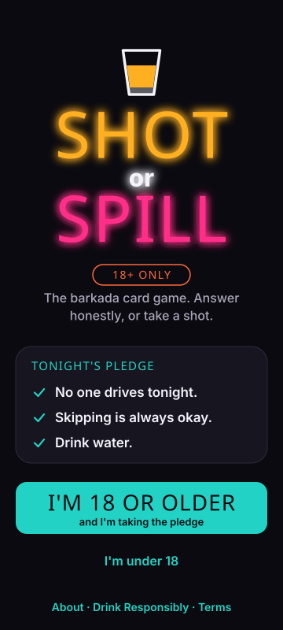
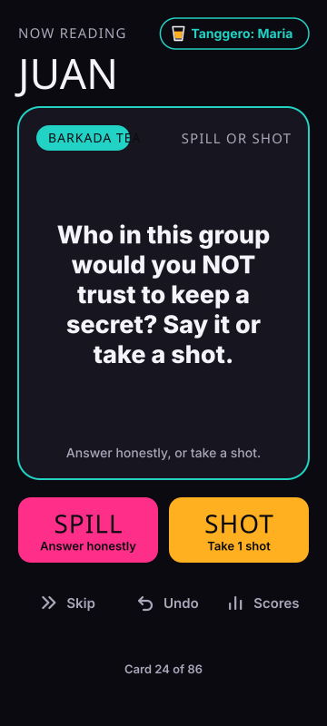
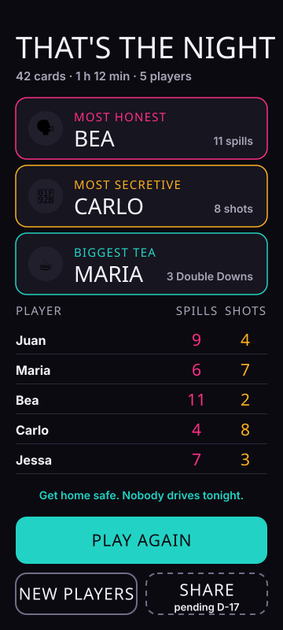

# Shot or Spill

A Filipino barkada drinking card game for adults (18+). It runs on one phone passed
around the table at an inuman. Each card asks a personal, funny, or awkward question,
and the player answers honestly (spill) or takes a shot.

**Core loop:** Draw a card → read it out loud → spill or shot → pass the phone.

It's a mobile-first web app with no install, no account, and no ads.

> **Status:** The game is playable end to end with all 360 cards, and the checks below
> pass. Phase 4 (playtests) is next: the cards and the playtest kit are ready, and the
> real inuman sessions need people at a table.

Live: [spill-or-shot.vercel.app](https://spill-or-shot.vercel.app/) ·
Repo: [github.com/rhon-dev/Shot-Or-Spill](https://github.com/rhon-dev/Shot-Or-Spill)

<p>



</p>

## Docs

| Doc | What's in it |
| --- | --- |
| [docs/PRD.md](docs/PRD.md) | Product requirements v0.3 (source of truth) |
| [docs/PHASES.md](docs/PHASES.md) | Phase-by-phase plan with gates, tasks, and requirement traceability |
| [docs/ARCHITECTURE.md](docs/ARCHITECTURE.md) | Planned technical design for the MVP build |
| [docs/DECISIONS.md](docs/DECISIONS.md) | Decisions log (D-01 to D-21) |
| [docs/DESIGN.md](docs/DESIGN.md) | Design spec: brand, tokens, screens, motion, accessibility |
| [docs/content-guide.md](docs/content-guide.md) | Rules for writing cards |
| [docs/content-review.md](docs/content-review.md) | Review log for both card batches, plus the table-read sheets |
| [docs/PLAYTEST.md](docs/PLAYTEST.md) | How to run the Phase 4 playtests: sessions, measures, device checklist, No Filter test |
| [docs/playtest-log.md](docs/playtest-log.md) | Blank results sheet for the playtests |

## Run it

Needs Node 22.12 or newer.

```sh
npm install
npm run dev       # local dev server; open the URL it prints on your phone or a narrow window
npm run check     # typecheck + card validation + WCAG contrast check + unit tests
npm run build     # validates cards, then builds to dist/
npm run size      # first-load JS budget: 150 KB gzipped (D-18)
npm run smoke     # plays a full night in headless Chromium against the build
npm run card -- "ghosted by someone"   # find a card's id from its text (or pass an id)
npm run mocks     # regenerate the design mocks in docs/design/
```

`npm run smoke` uses a locally installed Chromium-based browser (Brave or Chrome on
macOS). To use a different one, set `CHROME_PATH`. Set `SHOTS_DIR` to save screenshots.
CI (`.github/workflows/ci.yml`) runs `check`, `build`, and `size` on every push.

## Cards

Cards live in `src/content/decks/`, one JSON file per deck. `npm run check` and
`npm run build` both validate them.

The validator checks every rule in the content guide it can check automatically:

- schema, ids, and deck ceilings
- placeholders and targets
- shots
- duplicate text
- Tagalog text and alcohol brand names

It prints a deck and type-mix report, and the run fails if any card breaks a rule.

## Roadmap

| Phase | Output | Time | Status |
| --- | --- | --- | --- |
| 0. Lock decisions | Open questions and PRD gaps resolved, PRD v0.3 | 2 days | Done |
| 1. Content v1 | Writing guide + 150 validated cards | 1 week | Done (table read moves to Phase 4) |
| 2. Design | Brand, card back, 6 key screens + all states (SVG mocks) | 1 week | Done |
| 3. Build MVP | Setup, game loop, counters, recap | 2 weeks | In review (needs a Vercel preview) |
| 4. Playtest | 4–5 real inuman sessions, reach 300+ cards | 1 week | In progress: 310 cards and the playtest kit are done; the sessions need Rhon |
| 5. Launch | Deploy, legal pages, analytics, share | 3–4 days | Not started |
| 6. v1.1 / v2 | Custom cards, PWA, then rooms | After launch | Not started |

## MVP scope (v1)

- 18+ age gate with a responsible-drinking pledge
- 2–12 players in a fixed seating order (seats 1–12, sorted by the host), plus a
  Tanggero the host picks, who passes to the next seat every 10 cards
- 6 decks (Warm Up, Barkada Tea, Love Life, Couples, Family & Adulting, No Filter),
  mostly hypothetical and generic questions, with an
  intensity filter (Chill / Spicy / No Filter)
- Card flip and swipe, SPILL and SHOT buttons, Skip always available, Undo
- Shot counters, a scoreboard, Water Break pacing, and a soft-cap warning
- End-of-night recap with awards
- Game state saved on the device, so a refresh keeps progress

**Not in v1:** accounts, payments, ads, multi-phone sync, Tagalog or Taglish card text,
alcohol brand partnerships, and explicit sexual content. The full list is in
[PRD §3 and §7](docs/PRD.md#3-goals-and-non-goals).

## Stack

- **App:** Vite + React 19 + TypeScript and Tailwind CSS v4, with themes built from
  `src/design/tokens.ts`.
- **Animation:** Motion (formerly Framer Motion). Its features load lazily.
- **State:** Zustand, persisted to localStorage.
- **Fonts and content:** self-hosted Anton and Inter (SIL OFL), and Zod-validated JSON
  cards bundled with the app.
- **Hosting:** Vercel, with security headers set in `vercel.json`.
- **Testing:** Vitest for unit tests, and Playwright Core for the browser smoke test.

The game rules are pure functions in `src/game/engine.ts`, kept separate from the UI.
Details are in [ARCHITECTURE.md](docs/ARCHITECTURE.md).

**Privacy:** no accounts and no backend. Player names and scores stay in the browser's
localStorage on the phone. Analytics are off in v1; Phase 5 turns them on (D-16).

## Drink responsibly

Shot or Spill is for adults 18+, the legal drinking age in the Philippines. The game
opens with this pledge: _No one drives tonight. Skipping is always okay. Drink water._

## Owner

Rhon
