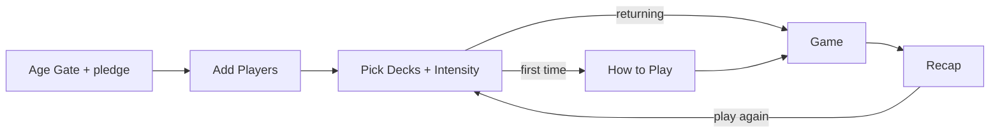

# Technical Architecture

Status: built in Phase 3, which is now in review. Implements
[PRD §11](./PRD.md#11-technical-approach) (v0.3). Items tagged D-xx refer to decisions in
[DECISIONS.md](./DECISIONS.md). All of them are accepted except D-17, which is deferred.

The build follows this plan. A few details differ:

- **Store key:** the localStorage key is `shot-or-spill`, and the version (1) is saved
  with the data.
- **Info pages:** they're hash routes (`#about`, `#drink-responsibly`, `#terms`), so the
  phone's back button closes them.
- **Animation loading:** Motion's animation features load after first paint, which
  keeps the first-load JS at about 115 KB with all 360 cards bundled.
- **Turn rules:** the PHASES.md "Phase 3 result" section lists the turn rules the build
  settled.

## Stack

| Layer | Choice | Notes |
| --- | --- | --- |
| Framework | Vite + React + TypeScript | D-06; static build, no server |
| Styling | Tailwind CSS | Tokens from Phase 2 |
| Animation | Motion (formerly Framer Motion) | `LazyMotion` with features loaded async, to stay in budget (D-18) |
| State | Zustand + `persist` (localStorage) | Versioned, with migrations |
| Content | One JSON file per deck, validated with Zod | Validator runs before every build |
| Tests | Vitest, Playwright Core | Engine and store unit tests; browser smoke test with a local Chromium |
| Hosting | Vercel (static) | Preview deploys per branch |
| Analytics | Plausible or Umami | D-16; anonymous events only |
| v2 backend | Supabase Realtime | Rooms only; nothing in v1 |

## App flow



The Game screen also opens the Scoreboard, the soft-cap warning, the reshuffle prompt,
and the per-type pickers (D-09, D-10, D-11). About, Drink Responsibly, and Terms can be
reached from any screen.

## Folder structure

```text
shot-or-spill/
├─ .github/workflows/ci.yml  # check + build + JS budget on every push
├─ docs/                     # PRD, phases, architecture, decisions, content guide, design spec
│  └─ design/                # generated SVG brand marks and screen mocks (Phase 2)
├─ public/                   # favicon, robots.txt
├─ scripts/
│  ├─ validate-cards.ts      # Zod content validation, runs before build
│  ├─ check-contrast.ts      # WCAG AA check of the design tokens
│  ├─ check-size.ts          # first-load JS budget (D-18)
│  ├─ smoke.ts               # end-to-end run in headless Chromium with the production CSP
│  ├─ find-card.ts           # look up a card by id or text (playtest notes)
│  └─ render-mocks.ts        # regenerates docs/design from tokens + real cards
├─ src/
│  ├─ content/
│  │  ├─ meta.ts             # deck metadata + Card type, no dependencies (app-safe)
│  │  ├─ schema.ts           # Zod schema, build-time only (keeps Zod out of the bundle)
│  │  ├─ cards.ts            # bundles the deck JSON for the app
│  │  └─ decks/*.json        # one file per deck
│  ├─ design/
│  │  └─ tokens.ts           # colors, type, spacing, motion; Tailwind imports these
│  ├─ game/
│  │  ├─ engine.ts           # pure rules: pool, shuffle, turns, pacing, names, awards
│  │  ├─ engine.test.ts
│  │  ├─ store.ts            # Zustand store + persistence, sanitize on load
│  │  ├─ store.test.ts
│  │  ├─ useApp.ts           # the app's store instance + reduced-motion hook
│  │  └─ types.ts
│  ├─ screens/               # Setup (age gate, players, decks, how to play), Game, Recap
│  ├─ components/            # Card, controls (ui), dialogs and sheets (overlays), art
│  ├─ pages/Info.tsx         # About, Drink Responsibly, Terms (lazy)
│  ├─ lib/                   # analytics wrapper (D-16), lazy Motion features
│  ├─ App.tsx
│  └─ main.tsx               # fonts, styles, root
├─ index.html
├─ tailwind.config.ts        # theme from tokens, loaded via @config
├─ vercel.json               # build settings + security headers
└─ package.json
```

## Content model

Card shape, from PRD §9 with the D-08 placeholders:

```ts
type Card = {
  id: string; // "love-031": deck prefix + 3 digits, unique across all decks
  deck: "warm-up" | "barkada-tea" | "love-life" | "family-adulting" | "no-filter";
  type:
    | "spill_or_shot"
    | "everyone_who"
    | "most_likely"
    | "hot_seat"
    | "double_down"
    | "water_break";
  intensity: 1 | 2 | 3;
  target: "current" | "p1" | "group" | "tanggero";
  text: string; // English; placeholders {p1}, {p2}, {tanggero}
  shots: 1 | 2; // 2 only for double_down
  tags: string[];
};
```

The build fails if any card breaks one of these rules:

- The shape doesn't match, or the card has unknown fields.
- `shots: 2` appears on any type other than `double_down`.
- A `water_break` card doesn't target `group`.
- Text uses `{p1}` or `{p2}` without `target: "p1"`.
- Intensity is above the deck ceiling: Warm Up 1, Barkada Tea 2, Love Life 3,
  Family & Adulting 2, No Filter 3.
- The file name doesn't match the deck, an id is duplicated, or text is duplicated
  across decks.

## Game state

Saved to localStorage under the key `shot-or-spill`, with the store version saved
alongside it. The table is the original plan; the fields as built are listed in `AppData`
and `Session` in `src/game/store.ts` and `src/game/types.ts`.

| Field | Purpose |
| --- | --- |
| `ageConfirmedAt` | F1. Expires after 30 days |
| `howToPlaySeen` | Show How to Play only the first time |
| `players[]` | `{ id, name, spills, shots }` |
| `config` | Selected decks, intensity, soft cap (default 6) |
| `session.queue` | Remaining card ids for this cycle |
| `session.current` | Current card id plus its **resolved text** and answering player |
| `session.turn` | Index of the current reader |
| `session.tanggero` | Start index plus count of completed cards |
| `session.pacing` | Cards since the last Water Break and the next target (12–15) |
| `session.log[]` | Resolved cards: card id, player ids, spills, shots |
| `session.previous` | Snapshot before the last resolved card, used by Undo |

Two design points:

- **Resolve placeholders once, at draw time,** and save the resulting text. If
  substitution ran on every render, a refresh or re-render would pick a new random
  `{p1}`, and F8 and F15 would both break.
- **Version the store.** When the shape changes, bump the version and add a migration. A
  saved state that can't be migrated resets the session but keeps the players.

## Engine rules

The engine is a set of pure functions: state in, state out, with no React. That makes it
easy to unit test, and it keeps v2 rooms possible, since the same state could be
broadcast later.

1. **Eligible pool (F5).** A card is eligible when all of these hold:
   - its deck is selected
   - its intensity is at or below the filter
   - it isn't a Water Break card (D-12)
   - if it uses `{p2}`, there are 3 or more players (D-08)
2. **Shuffle (F9).** Use a Fisher–Yates shuffle once per cycle and draw from the front
   of the queue. Nothing repeats until the queue is empty, and then the game shows the
   reshuffle prompt.
3. **Draw (F8).** Fill the placeholders. `{p1}` and `{p2}` are different players, and
   neither is the reader. `{tanggero}` is the current Tanggero.
4. **Resolve, by card type:**
   - `spill_or_shot` and `double_down`: Spill or Shot. A shot logs `card.shots` to the
     answering player: the reader, or the `{p1}` player (D-09).
   - `hot_seat`: the "Shots taken: 0–3" stepper (D-11).
   - `everyone_who` and `most_likely`: the "Who drank?" picker, with 1 shot for each
     selected player (D-10).
   - `tanggero` target: a player picker for who answers (D-09).
   - `water_break`: a Done button only. Nothing is logged.
5. **Turn (F6).** After a card is resolved, the turn moves to the next reader.
6. **Skip (F11, D-13).** The same reader gets the next card. Nothing is logged, and the
   skipped card is used up for this cycle.
7. **Tanggero (F3, D-13, D-23).** Picked by the host (seat 1 by default), never random.
   Moves to the next seat after every 10 completed cards and shows as a badge.
   `setTanggero` hands it to someone else for the rest of the current round.
8. **Water Break (F12, D-12).** After a random 12–15 completed cards, the engine inserts
   one, then picks a new random target.
9. **Soft cap (F12).** When a player's shots reach the cap, show the warning once for
   that player ("Juan, that's 6. Water round for you?"). If Undo drops them back below the
   cap, the warning can fire again.
10. **Undo (F16).** Restore `session.previous`. This brings back the scores, turn,
    Tanggero, pacing counters, and the card itself. One level of undo is enough for F16.
11. **Recap (F14, D-19).** Work out the awards from `session.log` when the game ends.

## Performance

Targets come from the PRD §11 quality bar.

- Animate only `transform` and `opacity`. The flip stays at 400 ms or less (F7).
- Respect `prefers-reduced-motion`, and add an in-app toggle. With reduced motion on, a
  crossfade replaces the flip.
- Self-host fonts with `font-display: swap`. Anton is Latin only. Inter ships several
  `unicode-range` subsets, so browsers download only the Latin file for English text. The
  page makes no third-party requests on load.
- Bundle the card JSON. About 360 cards is small, so there's no fetch.
- Split info pages out of the first load. A CI size check enforces the JS budget (D-18).
- Test on a budget Android phone in Phase 3.5 and Phase 4.

## Accessibility

- WCAG AA contrast for all text and buttons. Pay special attention to pink and amber on
  near-black, and to text on the bright buttons.
- Tap targets of 48px or more, with SPILL and SHOT in thumb reach.
- New card text is announced through an `aria-live` region. Buttons have text labels, so
  meaning never depends on color alone.
- Visible focus states, and focus moves to the new card after each draw.
- Card text auto-resizes but never drops below a minimum size.
- Full WCAG conformance needs manual testing with assistive technologies and an expert
  review. That pass is planned for Phase 5.

## Privacy and security

- No accounts and no backend in v1. Player names stay in localStorage on the device.
- Analytics events carry only card id, deck, type, and choice. They never include names
  or free text (D-16).
- Static hosting on Vercel, with security headers set in `vercel.json`:
  - Content-Security-Policy
  - Referrer-Policy
  - X-Content-Type-Options
- v1 has no secrets in the client, because it needs none.
- v1 exposes no API endpoints, so there's no authentication surface. That's intentional
  for a single-phone game. v2 rooms will need access rules and rate limits for room
  codes, and those get designed then.

## Testing

- **Vitest unit tests for the engine:**
  - nothing above the intensity filter is drawn (F5)
  - no repeats within a cycle (F9)
  - placeholders never pick the reader (F8)
  - Tanggero rotation (F3)
  - Water Break cadence (F12)
  - Undo restores the previous state (F16)
  - soft-cap warning fires once (F12)
- **Store tests:** persistence round-trip and migrations (F15).
- **Content validator:** runs before every build and in CI.
- **Manual checks:**
  - device checklist: budget Android with Chrome, iPhone with Safari
  - readability in a dim room
  - first card in under 20 seconds
