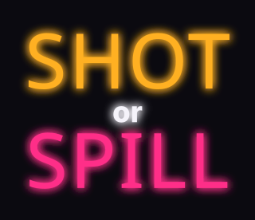
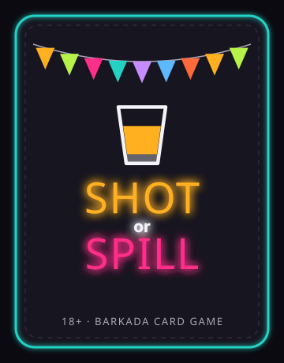
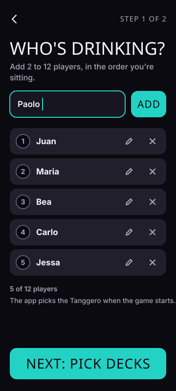
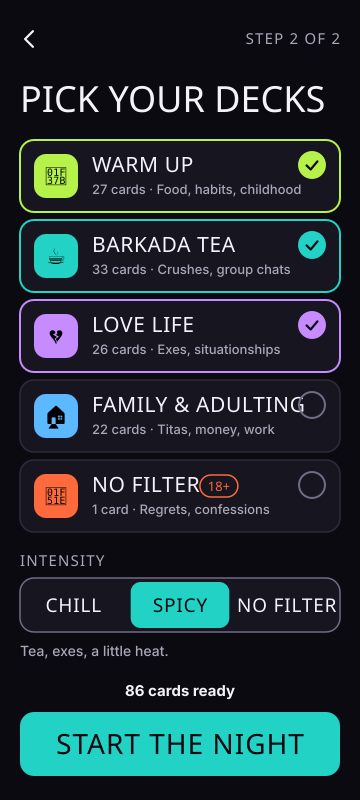
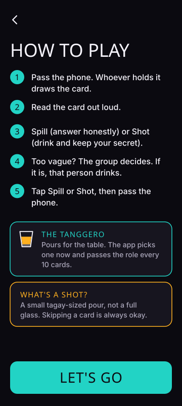

# Design Spec

This is the Phase 2 deliverable ([PHASES.md](./PHASES.md#phase-2--design-1-week)). It
implements [PRD §10](./PRD.md#10-ux-and-design) (v0.3).

| | |
| --- | --- |
| **Status** | In review, waiting on Rhon's sign-off |
| **Format** | SVG mocks in the repo instead of Figma (D-20, proposed) |
| **Still open** | D-17: whether Recap gets a Share button. Social handles also need a manual check before the brand is final. |

Everything visual comes from one file, [`src/design/tokens.ts`](../src/design/tokens.ts),
which covers color, type, spacing, card-text sizing, and motion. The mocks are generated
from those tokens, and the Phase 3 Tailwind config will import the same file, so the
designs and the app can't drift apart.

```sh
npm run mocks            # regenerate docs/design/**/*.svg from the tokens and real cards
npm run check:contrast   # WCAG AA check of every color pair (also part of npm run check)
```

The SVGs request Anton and Inter. If those fonts aren't installed, they fall back to
Impact and Helvetica/Arial, and that's how they render on GitHub. Phase 3 self-hosts the
real fonts. To refine the mocks in Figma, drag any SVG onto the canvas.

---

## 1. Brand

<p>

&nbsp;

</p>

- **Wordmark:** stacked **SHOT** (amber) / **or** / **SPILL** (hot pink) in the display
  face, with a neon glow. The colors match the two buttons, so the logo teaches the game.
- **Card back:**
  - teal neon border
  - fiesta bunting with one flag per brand and deck color
  - a tagay glass with an amber pour
  - the wordmark
  - "18+ · BARKADA CARD GAME"
- **Motifs:** the tagay glass marks the Tanggero, and a water glass marks pacing. Both
  are simple line icons, so they work at 15px.
- **Mood (PRD §10):** sari-sari store neon on a near-black night, a tarpaulin-style
  condensed display face, and fiesta bunting.

## 2. Tokens

### Color

| Token | Hex | Use |
| --- | --- | --- |
| `bg` | `#0B0A10` | Page background |
| `surface` / `surfaceRaised` | `#17151F` / `#221F2D` | Cards, sheets, inputs / chips, rows |
| `text` / `textMuted` | `#F5F3FA` / `#ABA7BA` | Body text / secondary text |
| `spill` | `#FF2E88` | SPILL button, spill counts |
| `shot` | `#FFB020` | SHOT button, shot counts, "who drank" chips |
| `accent` | `#22D3C5` | Primary buttons, links, Tanggero badge, "who answers" chips |
| `danger` | `#FF6B6B` | Errors, soft-cap highlight, End the night |
| `borderStrong` | `#726C88` | Input and control borders (≥ 3:1) |
| `textOnBright` | `#0B0A10` | Labels on pink, amber, teal, and deck fills |

**Deck accents:**

| Deck | Accent |
| --- | --- |
| Warm Up | `#B6F24A` lime |
| Barkada Tea | `#22D3C5` teal |
| Love Life | `#C58BFF` violet |
| Family & Adulting | `#5CB8FF` sky |
| No Filter | `#FF6A3D` red-orange |

The deck accents sit away from Spill pink and Shot amber. Every deck also has a name and
an emoji, so color is never the only cue.

### Type

| Role | Face | Size |
| --- | --- | --- |
| Wordmark, titles, buttons, labels | **Anton** (SIL OFL) | 52 / 36 / 30 / 15 px |
| UI text | **Inter** (SIL OFL) | 18 / 16 / 14 px, never smaller for anything essential |
| Card questions | **Inter 800** | 30 → 21 px (see §4) |

The card questions use Inter rather than Anton. All-caps condensed type gets hard to
read past a few words, and some questions run 20+ words in a dim room.

### Layout

- **Baseline:** 360 × 800, a budget Android phone.
- **Width:** the layout stretches up to 480px wide, then centers.
- **Spacing:** 20px gutter on a 4px spacing scale.
- **Radii:** 8, 14, 20, and 24 for cards.
- **Tap targets:** 48px minimum. SPILL and SHOT are 72px tall.
- **Thumb zone:** SPILL and SHOT sit 68–78% of the way down the screen.
- **Player names:** 1–16 characters, so a name never breaks a card.

## 3. Screens

The six key screens follow the PRD §10 flow: Age Gate → Add Players → Pick Decks +
Intensity → How to Play (first time only) → Game → Recap.

<p>



</p>
<p>



</p>

| # | Screen | Covers | Notes |
| --- | --- | --- | --- |
| [01](design/mocks/01-age-gate.svg) | Age gate | F1, PRD §12 | The pledge sits on the gate; one tap both confirms 18+ and takes the pledge. Remembered for 30 days. Links to About, Drink Responsibly, and Terms. |
| [02](design/mocks/02-players.svg) | Add players | F2 | Enter to add, players listed in seating order, edit and remove on each row, duplicate-name error inline (see components). Next unlocks at 2 players. |
| [03](design/mocks/03-decks.svg) | Decks + intensity | F4, F5, D-15 | Multi-select tiles show card counts at the current intensity. Live "N cards ready". |
| [04](design/mocks/04-how-to-play.svg) | How to Play | PRD §5, §12 | Five rules, the Tanggero, and the definition of a shot. Shown the first time only (PRD §10). |
| [05](design/mocks/05-game.svg) | Game | F3, F6, F7, F10, F11 | Top to bottom, per PRD §10: reader and Tanggero badge, card, SPILL / SHOT, Skip · Undo · Scores. |
| [06](design/mocks/06-recap.svg) | Recap | F14, D-19 | Three awards, then the final scoreboard. Play again keeps the players. The Share button is a dashed placeholder until D-17 is decided. |

### Secondary states

This table covers every state that Phase 3 builds.

| # | State | Covers |
| --- | --- | --- |
| [07](design/mocks/07-pass-the-phone.svg) | Pass the phone: card back, tap or swipe to flip | F6, F7 |
| [08](design/mocks/08-water-break.svg) | Water Break card | F12, D-12 |
| [09](design/mocks/09-who-drank.svg) | Group card: "Who drank?" chips | D-10 |
| [10](design/mocks/10-hot-seat.svg) | Hot Seat: shots-taken stepper | D-11 |
| [11](design/mocks/11-tanggero-pick.svg) | Tanggero card: who answers? | D-09 |
| [12](design/mocks/12-scoreboard.svg) | Scoreboard sheet + game settings | F13, F12 |
| [13](design/mocks/13-soft-cap.svg) | Soft-cap warning | F12 |
| [14](design/mocks/14-adult-confirm.svg) | No Filter confirmation | F4, D-14 |
| [15](design/mocks/15-decks-too-few.svg) | Too few cards: Start disabled | D-15 |
| [16](design/mocks/16-reshuffle.svg) | Every card played: reshuffle prompt | F9 |
| [17](design/mocks/17-under-18.svg) | Under 18 | F1 |
| [18](design/mocks/18-drink-responsibly.svg) | Info page template (Drink Responsibly; About and Terms use the same layout) | PRD §12 |
| [19](design/mocks/19-components.svg) | Components: buttons, focus ring, chips, inputs and errors, badges, intensity control, stepper, toggle, toast, deck tiles | All |

### Game flow

1. **Draw.** The next card appears face down, with "PASS THE PHONE TO Bea" (07). The
   new reader taps the card, or swipes it, to flip it. The previous player never sees
   the next question.
2. **Read.** The face-up card shows:
   - the deck chip, colored with the deck accent
   - the card type
   - the question, with names already filled in
   - a one-line hint on how the card type works
3. **Resolve.** What the reader taps depends on the card type (PRD §5 logging table):
   - **Spill or Shot, Double Down:** SPILL or SHOT. The sub-label says how many shots.
   - **Everyone Who, Most Likely To:** tap who drank (amber chips), then Done (09).
   - **Hot Seat:** set the shots taken, 0–3, then Done (10). The named player answers;
     the header still shows the reader.
   - **Tanggero picks:** tap who was picked (teal chips), then SPILL or SHOT, logged to
     that player (11).
   - **Water Break:** Done only (08).
4. **Pass.** Each resolved card leads to the next reader's card back.

Skip, Undo, and Scores are always on the face-up card. On the card back they're Undo
and Scores only.

## 4. Card text sizing

Measured on the text **after** names are filled in, using `cardTextSize()` in the tokens
file.

| Characters | Size | Compact card |
| --- | --- | --- |
| ≤ 60 | 30px | 27px |
| ≤ 90 | 27px | 24px |
| ≤ 130 | 24px | 21px |
| longer | 21px | 21px |

- **Compact cards:** these are the shorter cards above a picker (09–11). They drop one
  size step and leave out the hint line, because the picker label already explains what
  to do.
- **Minimum size:** 21px. Line height is 1.22, weight 800, centered.
- **Current deck:** the longest card is 120 characters, which fits at 24px, or 21px
  compact. Phase 3 should still clamp with a scroll fallback in case a future card or a
  long name overflows.

## 5. Motion

| Motion | Spec |
| --- | --- |
| Card flip | 320 ms (F7 needs under 400 ms), `rotateY` with perspective, ease-out `cubic-bezier(0.2, 0.8, 0.2, 1)` |
| Swipe | On the card back, a swipe flips the card. On a face-up card, swiping left skips it (nothing is logged). Triggers past 80px or 500 px/s; otherwise the card springs back. The card slides out in 200 ms. |
| Sheets and dialogs | 240 ms slide or fade |
| Reduced motion | A 150 ms crossfade replaces the flip and swipe. It's on when the OS asks for it, and there's an in-app toggle (12). |
| Rules | Animate `transform` and `opacity` only. The neon glow is static, never animated. |

**SPILL and SHOT have no swipe gesture.** A gesture could log a choice by accident, and
a swipe can't show who drank or how many shots were taken.

## 6. Accessibility

- **Contrast:** `npm run check:contrast` checks 46 pairs and all of them pass AA. The
  lowest text pair is Spill pink on raised surfaces, at 4.61:1. Labels on bright fills
  always use near-black text.
- **Tap targets:** all tap targets are 48px or more. That includes chips (48),
  steppers (48–60), and SPILL and SHOT (72).
- **Focus:** a 2px white ring sits 2px outside every focusable control. Dialogs and
  sheets trap focus and return it when they close, and Escape closes the scoreboard.
- **Screen readers:**
  - The card question goes in an `aria-live="polite"` region, and focus moves to the
    card after each flip.
  - The Undo toast is announced.
  - Emoji are decorative (`aria-hidden`), and every deck has a text name.
  - Chips and deck tiles are toggle buttons with `aria-pressed`.
- **Not color alone:** SPILL and SHOT carry text labels and sub-labels, and selected
  chips and tiles show a check mark.
- **Testing:** this covers design-level checks only. Full WCAG validation needs manual
  testing with assistive technologies and an expert accessibility review. That pass is
  in the Phase 5 launch audit.

## 7. Design calls for Rhon to review

These go a step beyond what the PRD spells out.

1. **Pass-the-phone step (07).** It adds one tap per turn, but the next question stays
   hidden until the right person is holding the phone.
2. **Choices only through buttons, never by swipe.** See §5.
3. **Water Break has no Skip.** PRD §12 says every card can be skipped. That rule
   protects people from questions, and a Water Break asks none. The PRD also says Water
   Breaks are "no exceptions". The alternative is to show Skip on Water Breaks too.
4. **Settings live in the scoreboard sheet (12).** The shot-warning number, reduced
   motion, and End the night are there, so the MVP needs no separate settings screen.
5. **"Water round" on the soft-cap warning (13) only closes the dialog.** The table
   handles the water; the app doesn't log anything.

## Phase 2 sign-off

- [x] Brand: wordmark and card back
- [x] Tokens: palette, deck accents, type scale, spacing, radii, motion
- [x] Six key screens at 360 × 800
- [x] Every secondary state Phase 3 builds (07–17), info page template (18), components (19)
- [x] Card text sizing rules, checked against the real cards
- [x] Motion spec with a reduced-motion fallback
- [x] WCAG AA contrast check passes (46 pairs)
- [ ] D-17 decided (the Share button on Recap stays a placeholder until then)
- [ ] D-20 approved (SVG mocks instead of Figma)
- [ ] Rhon approves the designs and the §7 design calls
